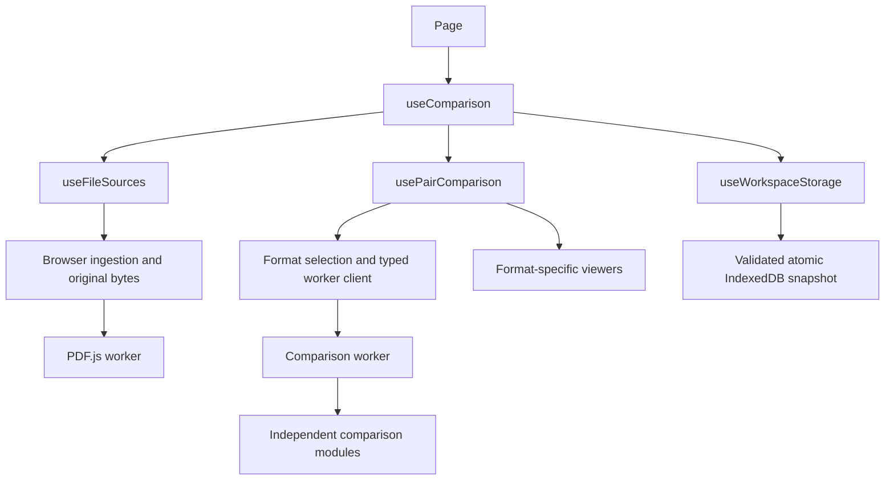

# Diffs - Developer Documentation

> Architecture, implementation notes, conventions, and verification guidance for Diffs development.

**Version:** 0.1.0 | **Last Updated:** 2026-06-06
**Scope:** Browser comparison, workspace state, local storage, UI conventions, testing, and maintenance.

---

## Table of Contents

- [Architecture Overview](#architecture-overview)
- [Technology Stack](#technology-stack)
- [Project Structure](#project-structure)
- [Runtime Flow](#runtime-flow)
- [Core Concepts](#core-concepts)
- [Workspace State](#workspace-state)
- [Comparison Formats](#comparison-formats)
- [Adding a Format](#adding-a-format)
- [Storage and Privacy](#storage-and-privacy)
- [UI and Design System](#ui-and-design-system)
- [Configuration](#configuration)
- [Error Handling](#error-handling)
- [Testing Suite](#testing-suite)
- [Build Engineering](#build-engineering)
- [Troubleshooting](#troubleshooting)
- [Maintenance Notes](#maintenance-notes)
- [Feedback](#feedback)

---

## Architecture Overview

Diffs is a modular Next.js application with a browser-owned comparison workspace. Dependencies flow from page composition to focused hooks and viewers, then to framework-independent comparison modules. Algorithms do not import React, hooks, storage, or components. Browser-only ingestion stays in `lib/utils/`. There is no server-side comparison service.



### Key Architectural Decisions

| Decision | Rationale |
| --- | --- |
| Focused workspace hooks | Loading, comparison jobs, and persistence have separate lifecycles, cancellation, and failure handling. |
| Independent comparison modules | Text, image, JSON, table, PDF, byte, and folder algorithms can evolve without importing UI or storage code. |
| Typed worker contracts | A discriminated task and reply map connects each job to its result type; exhaustive dispatch exposes missing handlers. |
| Original-byte preservation | Fingerprints and byte comparison use original content even when review uses decoded or normalized representations. |
| Bounded work | Input, output, geometry, and runtime limits keep large or malformed inputs from monopolizing the browser. |
| Explicit retention | Temporary sessions are the default; opt-in reload recovery uses validated atomic snapshots. |

---

## Technology Stack

| Area | Technology |
| --- | --- |
| Runtime and language | Node.js 24+, npm, strict TypeScript |
| Application framework | Next.js App Router, React, React Compiler |
| Interface | CSS custom properties, Tailwind CSS tooling, Lucide icons |
| Editable text | CodeMirror state, view, commands, and merge packages |
| Text and image algorithms | jsdiff and Pixelmatch |
| PDF text extraction | PDF.js and a dedicated module worker |
| Background work | Web Workers, OffscreenCanvas, image bitmaps |
| Fingerprints and storage | Web Crypto SHA-256, IndexedDB, sessionStorage |
| Local verification | ESLint, TypeScript, Node test runner |

Dependency ranges and commands live in `diffs/package.json`; exact resolved versions live in `diffs/package-lock.json`. Keep changes to both files consistent.

---

## Project Structure

The repository separates public documentation and branding from the application:

```text
diffs/
  assets/                        Repository branding
  diffs/                         Next.js application
  CHANGELOG.md                   Version-specific changes
  DEVELOPMENT.md                 Architecture and developer guidance
  LICENSE.md                     Source license
  PRIVACY.md                     File access, storage, and hosting policy
  README.md                      Public project overview
  TASKS.md                       Unfinished work
```

Within the application directory:

```text
diffs/
  scripts/prepare-pdf-assets.ts   Copy installed PDF support assets locally
  src/
    app/                         Composition, metadata, OLED-black styles
    components/comparison/
      FileWorkspace.tsx          Source selection, limits, compare action
      ComparisonView.tsx         Pair selection and result/view dispatch
      FileDetails.tsx            Original-byte fingerprints and verification
      data/                      JSON, table, PDF, folder, and byte viewers
      data/shared.tsx            Report export, paginated search, values/counts
      text/                      Editable pasted diff and read-only file review
      text/TextMergeEditor.tsx   CodeMirror lifecycle, selection, history, layout
      image/                     Pixel review, geometry, details
    hooks/
      useComparison.ts           Small workspace composition facade
      useFileSources.ts          File/folder ingestion, cancellation, budgets
      usePairComparison.ts       Candidate jobs, cache/options, stale-result guards
      useWorkspaceStorage.ts     Restore, opt-in retention, save status
      useTextComparison.ts       Debounced source-text worker requests
      useTextActions.ts          Shared copy/patch export lifecycle
      useImageZoom.ts            Shared image geometry and pointer controls
    lib/
      types.ts                   Serializable sources, jobs, results, reply map
      constants.ts               Shared budgets and defaults
      session.ts                 Pure snapshot validation and compatibility
      comparison/
        engine.ts                Automatic format selection and job routing
        client.ts                Typed worker requests and lifecycle
        text.ts / image.ts       Text alignment / rendered pixel comparison
        editor.ts                Bounded editor diff and whitespace position maps
        json.ts / table.ts       Lossless JSON / delimited records
        binary.ts / folder.ts    SHA-256, offset ranges / path manifests
        pdf.ts                   Pure extracted-page summaries
      utils/
        file.ts                  Classification, original bytes, UTF-8, downloads
        folder.ts                Safe relative paths and folder ingestion
        pdf.ts                   Lazy PDF.js extraction in a dedicated worker
        image.ts                 Browser image decoding and pixel budgets
        storage.ts               Atomic IndexedDB reads/writes and save queue
    workers/comparison.worker.ts Exhaustive task dispatch, error replies
  tests/
    *.test.ts                   Algorithm, ingestion, storage regressions
```

Application code, test helpers, and build scripts use TypeScript. Tool configuration uses TypeScript or JSON. Keep page composition, ingestion, algorithms, storage, and format-specific presentation in their owning directories. A new format should extend its own comparator and viewer rather than spread parsing or persistence across components.

---

## Runtime Flow

1. **Initialize:** The page composes `useComparison`, which prepares temporary workspace state and asks `useWorkspaceStorage` whether this tab has an opted-in snapshot.
2. **Load sources:** `useFileSources` validates and reads selected files or folders sequentially, preserves original bytes, and derives text, images, or PDF pages when needed.
3. **Select a pair:** The user chooses an original and a candidate. Only the active candidate needs a computed result.
4. **Compare:** `usePairComparison` selects a format and submits a typed worker request. Revision checks prevent old jobs from publishing after a change or cancellation.
5. **Review:** `ComparisonView` selects the format-specific viewer. Pasted text uses editable CodeMirror panes with worker-backed counts and validation.
6. **Export:** Shared actions create patches, PNG differences, or JSON reports from the requested result.
7. **Retain or reset:** If retention is enabled, validated snapshots are queued in IndexedDB. Reset clears workspace state and requests removal of the tab's saved record.

---

## Core Concepts

| Concept | Contract |
| --- | --- |
| Original | The selected source against which candidates are compared. Changing it invalidates affected results. |
| Source | A regular file with retained bytes and fingerprint, or a folder manifest with relative paths, sizes, and fingerprints. |
| Derived representation | Decoded text, rendered pixels, or extracted PDF pages. A match here does not establish byte identity. |
| Comparison result | A serializable, format-specific value with explicit matching rules and bounded output. |
| Job revision | A guard that prevents stale asynchronous results from replacing the active workspace. |
| Session snapshot | A validated record of source order, original selection, pasted text and format, and input mode. Snapshot schema versions are independent of application versions. |

---

## Workspace State

`useComparison` owns workspace data and composes three independent lifecycles. Hooks receive stable snapshot/update callbacks rather than importing each other. A live snapshot prevents back-to-back input actions from reading stale React state. `FileWorkspace` owns file controls; `ComparisonView` chooses a format-specific viewer. Viewers never write session records or load source files.

File batches load sequentially with per-file failures. Every regular file keeps its original bytes and SHA-256; decoded text, rasterized SVGs, and extracted PDF pages are separate derived representations. Unknown formats become binary sources rather than being decoded as text. Folder snapshots retain relative paths, sizes, and individual SHA-256 values, releasing file contents after hashing.

Only the selected candidate is computed. Result caching includes comparison options. A newer run, file change, original change, reset, or cancellation invalidates the previous revision before it can publish. `client.ts` terminates comparison workers on completion, cancellation, error, and timeout. `WorkerResultMap` ties each task kind to its reply type; callers cannot request an unrelated result type. Dispatch is exhaustive, so new tasks require an explicit worker branch.

Source loading has its own revision and AbortController. Removing a source, resetting, starting another selection, or unmounting invalidates pending reads. PDF extraction uses its own module worker, cloned bytes to avoid detaching the retained original, a 30-second limit, and local support assets. Browser file/image APIs may finish an operation internally, but invalidated results cannot enter the workspace. Comparison jobs have a 15-second limit.

---

## Comparison Formats

### Pasted text

`PastedWorkspace` composes one pair of editable CodeMirror merge panes and optional structured results. Sources stay controlled by the workspace session while CodeMirror owns cursor and selection, native paste, composition, history, and viewport rendering. Wrapping is enabled by default. Desktop panes share vertical scrolling; mobile panes stack with linked individual scrollers.

A 40 ms / 500-scan bounded editor diff keeps visual feedback immediate; the worker supplies counts and validation. Whitespace review normalizes a derived representation and maps highlights back to original UTF-16 offsets. Toggling whitespace preserves editor history, selection, and scroll without rewriting source text. Recreating a merge view for diff options uses the public `historyField` initializer.

Source limits are enforced before accepting an edit, with visible rejection of oversized input. Reset unmounts the editors and discards history. Manual browser verification should exercise native paste, composition, undo and redo, and responsive layout with synthetic documents.

### Text

Line tokens retain endings and line numbers. Alignment and character highlighting have budgets; fallback preserves both full sources and announces line-only highlights. Patches use unnormalized sources, retain EOF markers, and apply to source text. Unwrapped long results use row virtualization; wrapping has a separate display limit.

### Images

Native dimensions align at the top left on a shared transparent canvas. SVG is rasterized during ingestion for browser compatibility. Pixelmatch includes fine edge changes and makes a white/transparent mask. Bitmaps close in `finally`. Sensitivity updates preserve the previous view while disabling exports; cancellation restores the displayed result's settings.

### JSON

A small parser preserves numeric literals, compares mathematical decimal values without IEEE-754 rounding, and rejects duplicate decoded object keys. Objects match by name, arrays by position, and paths use JSON Pointer (empty string is the document). Limits: 100 nested levels, 50,000 values, 20,000 changes, and 2 million combined output characters to prevent repeated long paths from exhausting memory. Raw literals in reports are strings.

### Tables

Strict quoted-cell parsing supports comma, tab, semicolon, and pipe. Auto detection is overridable; `.tsv` prefers tab. Duplicate/empty headings, ragged rows, and duplicate/empty row keys fail explicitly. Heading matching ignores column order. Rows match by position unless the user selects a unique key; keyed matching ignores row order. Cell values compare as strings, preserving leading zeroes. Empty cells and absent columns remain distinct. Blank records are skipped. Results paginate in groups of 100.

### PDF

PDF.js extracts selectable text and the pure comparator summarizes pages by position. Reviewers can unlink page selectors to align shifted pages manually. Fonts/layout/images are outside this comparison. Blank extraction never proves visual equivalence; scanned files get an explicit OCR notice. Patch export is disabled for PDF page text because it cannot patch PDF bytes.

### Bytes

Byte comparison uses matching offsets, including differing tails, and calculates SHA-256 over the full original arrays. All differences count; only the first 2,000 contiguous ranges are retained. Ranges are half-open `[start,end)` internally. The hex viewer renders 256 bytes per side at a time. Insertions shift subsequent offsets; no format-specific edit script is inferred.

### Folders

Exact, case-sensitive relative paths identify files. Matching hashes and sizes establish matching bytes. Renames appear as removal/addition; empty directories are excluded. Paths reject absolute segments, traversal, backslashes, and NULs. Reports contain fingerprints and paths rather than source content.

---

## Adding a Format

1. Define serializable source fields (only if needed), a discriminated result, a worker task, and its reply in `lib/types.ts`. Keep derived content separate from original bytes.
2. Add a pure, bounded comparator under `lib/comparison/`, with explicit matching rules, malformed-input behavior, and representative unit tests. Do not add React or storage dependencies.
3. Add ingestion/classification and limits only when the format needs decoding. Heavy decoding belongs in a worker. Preserve bytes for the exact comparison fallback; avoid network fetches for document content/resources.
4. Extend `engine.ts` routing and the exhaustive worker dispatch. Keep automatic selection predictable and provide a useful error or byte fallback for mixed inputs.
5. Add one viewer under `components/comparison/`; connect it in `ComparisonView`. Reuse shared paging/search/report controls. Keep format options usable after an error. Add pasted-text support only for formats that make sense as text.
6. Extend `validateSession`, increment the snapshot version if its contract changes, and preserve compatibility deliberately. Verify ingestion → review → options → export → reload in a production browser, plus mobile and cancellation.
7. Document semantic limits and privacy implications in the README. No new format should require editing unrelated comparison algorithms or job/retention hooks.

---

## Storage and Privacy

Temporary is the default. **Remember this tab** stores ordered sources, the original ID, pasted text/format, and input mode in one atomic `diffs-workspace` / `sessions` IndexedDB record. A tab ID and retention preference live in sessionStorage. Version 2 preserves bytes and format-specific source data; version 1 text/image snapshots still load. Restore validates IDs, budgets, safe paths, fingerprints, and derived content, and recomputes regular-file fingerprints from stored bytes.

Writes are serialized and debounced. Retention changes and Reset queue an immediate write/delete. Storage errors are visible and a failed restore blocks automatic overwriting until the user chooses retention or resets. A new tab starts separately; browser tab duplication can inherit sessionStorage. This is reload recovery, not a durable session library or encrypted backup. The legacy `diffs-storage` database is not automatically migrated or deleted. Clearing site data removes legacy records too.

There are no comparison server routes, analytics, remote fonts, or content uploads. PDF support assets come from the installed dependency and are copied to ignored `public/pdf-assets/` by `postinstall` and `prebuild`, including its license. No CDN is needed. Don't edit generated assets or commit them; update the dependency and regenerate. Keep private data out of logs and diagnostic reports.

The [privacy policy](PRIVACY.md) describes user-facing storage and hosting behavior. Do not describe the browser application as guaranteed offline: it has no service worker, and loading its application and PDF assets requires access to the serving host.

---

## UI and Design System

Use short, concrete UI wording, an OLED-black base, Git-style red/green diff highlights, semantic controls, accessible labels, and signs/text alongside color. Shared contrast roles live in `globals.css`; the CodeMirror theme consumes those variables too. Target at least 7:1 for regular text (including secondary labels, placeholders, and gutters) and 3:1 for control boundaries on their actual backgrounds. Keep disabled labels readable, use clear selected/focus states, and check mobile overflow when changing typography. Keep algorithms independent of React and results serializable. Preserve source content; normalized equivalence must not claim byte identity. Avoid dependencies where the platform/current packages suffice.

The page owns workspace composition, shared layout owns the footer, and each comparison format owns its review controls. Reuse shared data-viewer search, pagination, and export components. Keep file loading, persistence writes, and parsing outside presentation components.

Repository branding lives in `assets/Diffs.svg`; the served browser icon lives in `diffs/public/Diffs.svg`. Keep icon references aligned with files that exist. Fonts and visual assets must remain local to the application.

---

## Configuration

| File or setting | Purpose |
| --- | --- |
| `diffs/.nvmrc` and `package.json` engines | Required Node.js runtime |
| `diffs/package.json` and `package-lock.json` | Commands, dependency ranges, and resolved dependencies |
| `diffs/tsconfig.json` | Strict typing and the `@/*` source alias |
| `diffs/next.config.ts` | Next.js and React Compiler configuration |
| `diffs/eslint.config.ts` | Next.js lint rules, loaded with native Node.js TypeScript support |
| `diffs/src/lib/constants.ts` | Source budgets, supported extensions, and comparison defaults |
| `diffs/src/app/globals.css` | Interface layout, contrast roles, and responsive behavior |

Start local development from the application directory:

```sh
cd diffs
npm ci
npm run dev
```

Open [localhost:3000](http://localhost:3000). No application secrets or comparison service configuration are required. Web Crypto requires HTTPS or localhost.

---

## Error Handling

- **Source failures:** Keep valid files from a batch and report individual failures. Reject unsupported dimensions, malformed data, and exceeded budgets explicitly.
- **Cancellation and timeouts:** Invalidate the owning revision and terminate worker resources. Late reads or replies must not re-enter the workspace.
- **Comparison failures:** Show a useful error while keeping format options and source selection available for recovery.
- **Storage failures:** Report save and restore errors visibly. A failed restore blocks automatic overwriting until the user explicitly changes retention or resets.
- **Source preservation:** Review options must not rewrite input. Exact patches use unnormalized sources; normalized or rendered equivalence must not claim byte identity.

---

## Testing Suite

Run checks from `diffs/` after installing dependencies:

```sh
npm run check
```

`npm test` runs TypeScript tests directly with Node's native type stripping. A small registration hook resolves the application's `@/*` aliases without compiling source. Tests check semantic behavior, preservation, malformed inputs, limits, original hashes, and restored records. Validation runs locally; the repository has no CI/CD workflows or deployment automation.

Choose checks that exercise the changed boundary. Algorithm work needs representative semantic, malformed-input, and budget cases; hook or viewer work needs practical browser verification of the affected flow. Documentation and asset-reference edits need link and path verification rather than a full production build.

---

## Build Engineering

From `diffs/`, build and serve the production application:

```sh
npm run build
npm start
```

The `postinstall` and `prebuild` hooks copy PDF.js support assets and its license from the installed dependency to ignored `public/pdf-assets/`. Never edit or commit generated PDF assets, `node_modules/`, `.next/`, or TypeScript build caches.

Keep resource-intensive installation and build commands serial. Verify the affected flows in a browser after changing worker bundling, PDF asset paths, or build configuration. CI/CD and hosting automation are outside the repository's local verification workflow.

---

## Troubleshooting

| Symptom | Check |
| --- | --- |
| SHA-256 is unavailable | Use HTTPS or localhost with a browser that supports Web Crypto. |
| A file or image is rejected | Check the source count, byte, character, line, pixel, and dimension limits in `lib/constants.ts`. |
| PDF text is empty | The PDF may be scanned. OCR, layout comparison, and image extraction are unsupported. |
| PDF support files are missing | Run `npm ci` or `npm run prebuild` from `diffs/` to regenerate local assets. |
| A saved workspace does not restore | Review the visible storage error. Avoid Reset if you still need the saved record; the app blocks automatic overwriting after restore failure. |
| Closed-tab records remain in storage | Clear the site's browser data to remove inaccessible or legacy records. |
| A new format is not selected | Check ingestion classification, engine routing, task and reply types, exhaustive worker dispatch, and viewer selection. |

---

## Maintenance Notes

- **Scope:** Keep changes focused. Prefer concrete improvements to existing module boundaries over speculative abstractions.
- **Documentation:** Keep the README user-facing, technical guidance here, and storage behavior in the privacy policy. Update links and limits when behavior changes.
- **Changelog:** Record completed, verified user-visible changes under the current version and preserve historical entries.
- **Version alignment:** Change the application version only when requested. Keep the package manifest, lockfile root metadata, and documentation version aligned.
- **Dependencies:** Use `npm ci` for the committed lockfile. Check compatibility with Next.js lint and compiler tooling before upgrading related packages; avoid forced dependency downgrades.
- **Persisted formats:** Keep schema versions separate from application versions. Update validation and compatibility coverage whenever stored contracts change.
- **Resource ownership:** Release workers and bitmaps on success, error, cancellation, and timeout. Do not retain folder file contents after hashing.
- **Privacy:** Keep source content out of logs and public diagnostic reports. Review local asset loading and source retention when adding a format.
- **Verification:** Use focused checks while iterating and review the complete diff before committing.

---

## Feedback

Diffs is a personal project. To report bugs, request features, or suggest improvements, open an issue on the [GitHub issue tracker](https://github.com/qtremors/diffs/issues). Include a minimal synthetic example and browser details rather than private files.

---

<p align="center">
  <a href="README.md">Back to README</a>
</p>
